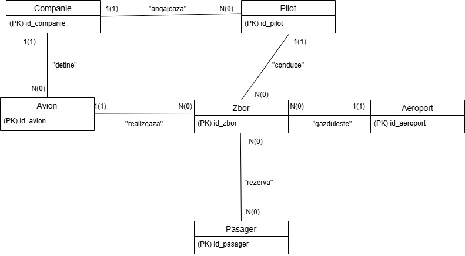
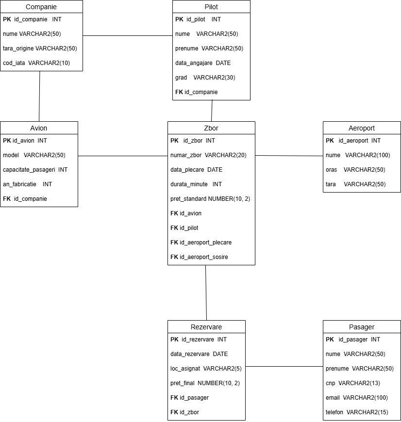

  <h1>✈️ Airport Activity Management System - Advanced PL/SQL</h1>
  
An Oracle database architecture for airport operations featuring advanced PL/SQL programming, complex business logic, and automated integrity checks.

---

## 📌 Short Description
Developed during the **Database Management Systems (SGBD)** course (Year 2, 2025-2026), this project implements the backend for an **Airport Activity Management System**. It centralizes the information needed for air operations: flight schedules (departures/arrivals), routes between origin and destination airports, airlines, their fleets (model, capacity, year of manufacture) and assigned pilots, as well as passenger bookings and seat allocation.

Beyond standard SQL, the system uses **Oracle PL/SQL** to embed business rules, data validation and consistency checks directly into the database layer (e.g. a pilot and an aircraft assigned to the same flight must belong to the same airline).

## 💻 Tech Stack & Tools

## 🗄️ Database Schema

The relational schema consists of the following core entities:
* **Airlines & Resources:** `COMPANIE` (airline), `AVION` (aircraft), `PILOT`
* **Infrastructure:** `AEROPORT` (airport)
* **Operations:** `ZBOR` (flight — with two distinct foreign keys to `AEROPORT` for the departure and arrival airport)
* **Passengers:** `PASAGER` (passenger), `REZERVARE` (booking)

### Entity-Relationship Diagram

### Conceptual Diagram

## ✨ Advanced PL/SQL Features Implemented

### 1. Collections (VARRAY, Nested Tables, Associative Arrays)
* `analiza_flota_si_piloti` analyzes an airline's fleet and pilots using a **VARRAY** of aircraft models, a **nested table** of pilots filled with `BULK COLLECT`, and an **associative array** (`INDEX BY VARCHAR2`) for per-pilot flight statistics.

### 2. Cursors
* `raport_zboruri_aeroport` uses an explicit cursor over airports and a **parameterized cursor** over the flights departing from each one, producing a nested departures report.

### 3. Functions & System Exceptions
* `gaseste_pasager_dupa_pret` is a function joining `PASAGER`, `REZERVARE` and `ZBOR`, handling `NO_DATA_FOUND` and `TOO_MANY_ROWS` gracefully.

### 4. User-Defined Exceptions
* `analiza_valoare_client_pilot` joins 5 tables (passenger → booking → flight → pilot → airline) and raises custom exceptions such as `exc_fara_istoric` (no travel history) and `exc_client_vip` (VIP client).

### 5. Database Triggers
* **DML Statement-Level Trigger:** `trg_monitorizare_zboruri` audits every `INSERT`, `UPDATE` or `DELETE` on the flight schedule.
* **DML Row-Level Trigger:** `trg_verificare_pret_zbor` blocks any flight price increase above 20% in a single update.
* **DDL Trigger:** `trg_audit_schema` fires `AFTER CREATE OR DROP ON SCHEMA` and logs structural changes.
* **Consistency Trigger (bonus requirement):** `trg_verificare_consistenta_companie` resolves the cycle in the diagram (`COMPANIE` → `PILOT`/`AVION` → `ZBOR`) by ensuring the pilot and the aircraft of a flight belong to the same airline.

## 📂 Repository Structure
| File | Description |
|------|-------------|
| `cod cerintele 4-12 + cerinta suplimentara sgbd.txt` | Full SQL & PL/SQL source code (DDL, data, subprograms, triggers) |
| `SISTEM DE MANAGEMENT AL ACTIVITATILOR AEROPORTUARE ... .docx` | Full project documentation (in Romanian) with diagrams and execution screenshots |
| `images/` | ER and conceptual diagrams |

## 🚀 Setup & Execution

Use an Oracle SQL environment (Oracle SQL Developer, Live SQL, etc.).

**1. Create the Schema:** Execute the `CREATE TABLE` statements to generate the tables and constraints.

**2. Populate Data:** Run the `INSERT` statements to populate airlines, airports, aircraft, pilots, flights, passengers and bookings.

**3. Compile PL/SQL Blocks:** Run the `CREATE OR REPLACE` scripts for the procedures, functions and triggers.

**4. Test the Logic:** Run the provided anonymous `BEGIN ... END;` blocks (with `SET SERVEROUTPUT ON`) to test the subprograms, exception handling and trigger constraints.

---

Author: <b>Condrea Ion-Luca</b> · Group 243

